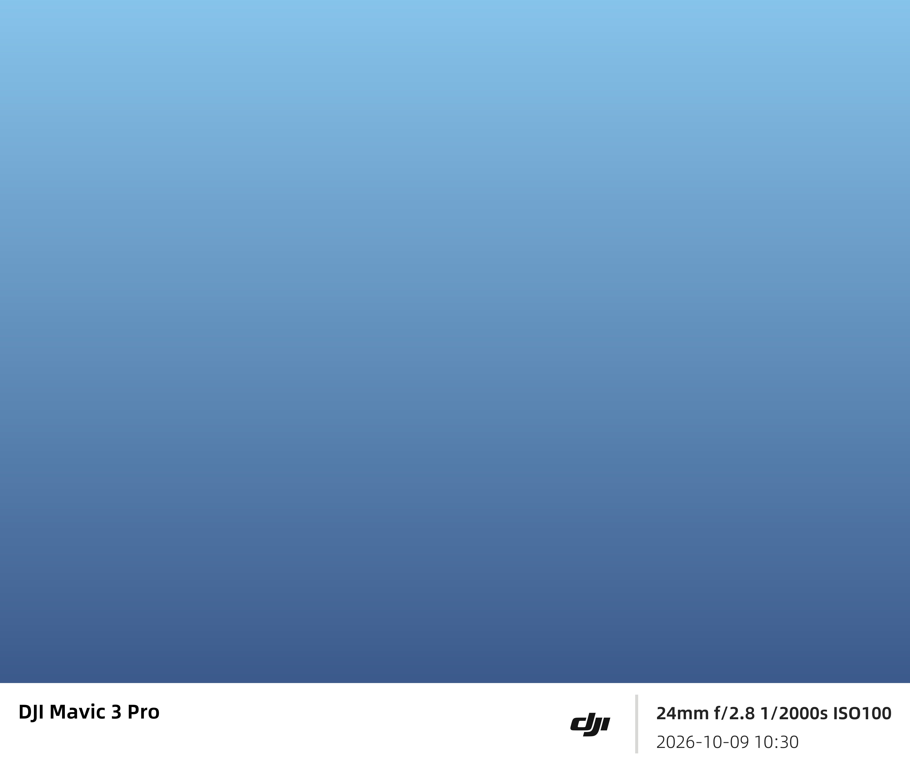

# 一帧水印 · 桌面版

给照片加上一条拍摄信息水印的本地工具。所有处理都在你自己的电脑上完成，**照片不会上传到任何服务器**。



## 特性

- **8 种排版模板**：白卡片、社交卡片、模糊背景、胶片边框、品牌留白、日期戳、极简右下角、自定义文字
- **自动读取 EXIF**：机型、镜头、焦距、光圈、快门、ISO、拍摄时间
- **20+ 品牌 Logo 自动匹配**：佳能、尼康、索尼、富士、徕卡、哈苏、松下、奥林巴斯、宾得、理光、大疆，以及苹果、华为、荣耀、小米、OPPO、vivo、三星、一加、魅族、摩托罗拉等手机品牌
- **262 个手机型号代号映射**：把 `V2419A`、`SM-S938`、`PKM110` 这类型号码还原成 `X200 Pro mini`、`Galaxy S25 Ultra`、`Reno 13`
- **宽度自适应**：竖幅、横幅、超宽画幅下自动缩放字号与间距，不挤压、不重叠
- **批量处理**：一次导入多张，统一套用模板
- **纯本地运行**：无网络请求、无账号、无遥测

## 快速开始

需要 Python 3.8 及以上。

```bash
pip install -r requirements.txt
python app.py
```

启动成功后，浏览器打开 `http://127.0.0.1:8765`。

> 注意：这个地址不是网站，而是**你本机的服务端口**，只在程序运行期间有效。程序没启动时访问会提示"无法访问此网站"，属正常现象。

Windows 也可以直接双击 `start.bat`——它会自动检查并安装缺失的依赖。

> **第一次用、不会装 Python？** 看 **[使用说明](使用说明.md)**，从装 Python 到导出成品逐步写清楚了，末尾附 9 条常见问题排查。

## 使用

1. 选择照片（支持多选）
2. 选模板、调参数（留白比例、信息条高度、Logo 位置、Logo 上下对齐）
3. 预览满意后导出

照片默认输出到 `output/` 目录。

## 模板

| 模板 | 说明 |
|---|---|
| 白卡片 | 照片下垫白边，信息条横排：左机型/镜头，右参数/日期 |
| 社交卡片 | 白卡片加圆角、光晕阴影与外留白，适合社交媒体 |
| 模糊背景 | 照片居中，四周用自身模糊放大填充 |
| 胶片边框 | 上下深色片基 + 齿孔，模拟 35mm 底片一格 |
| 品牌留白 | 四周留白加底部品牌 Logo，接近相框 |
| 日期戳 | 右下角橙色数字日期，模拟胶片机的日期打印 |
| 极简右下角 | 一行小字贴右下角，无底色，最不打扰画面 |
| 自定义文字 | 纯自定义文字，支持多行，位置与透明度可调 |

## 目录结构

```
watermark.py          渲染引擎（Pillow 直接绘制）
app.py                Flask 本地服务
static/index.html     网页界面
assets/fonts/         字体（阿里巴巴普惠体 + Roboto）
assets/logos/         品牌 Logo
tests/ref/            各模板的参考效果图
requirements.txt      依赖清单
使用说明.md            详细使用文档（安装 / 参数 / 常见问题）
```

## 关于排版

这套排版的核心不是"把字放上去"，而是让文字在任何画幅下都保持同样的视觉比例：

- 信息条高度取照片高度的 12%（可在界面调整到 18%）
- 字号不是固定值，而是由行盒高度推出（字号 = 行盒高 ÷ 1.4023，对应普惠体的行高系数）
- 对齐方式只有两种是正确的：底部对齐，或全部左对齐
- Logo 按文字墨迹中心对齐，而不是按行盒
- 分隔线用 `#D8D8D6` 浅灰而非纯白，在白底上才有层次

这些参数都写在 `watermark.py` 里，可以按自己的审美调整。

## 已知限制

- **vivo 天玑机型读不到机型**：部分 vivo 手机（如 X200 Pro mini）拍出的照片，EXIF 里根本没有 `Make`/`Model` 字段——相机应用只写了 `Software: MediaTek Camera Application`。这不是解析问题，数据本身就不在文件里。界面提供了手动填写机型的入口作为兜底。
- **微信转发的照片没有 EXIF**：微信会重新编码图片并剥离元数据，这类照片只能显示时间或手填机型。
- 型号映射表覆盖主流机型，未收录的型号会原样显示型号码。

## 致谢

- 排版设计风格参考了开源项目 [semi-utils](https://github.com/leslievan/semi-utils)（Apache License 2.0）。本项目为独立实现，代码与其无复用关系。
- 字体：[阿里巴巴普惠体](https://fonts.alibabagroup.com/)（免费商用授权）、Roboto（Apache License 2.0）。
- 品牌 Logo 的商标权归各品牌所有，此处仅用于指示照片的拍摄设备。

## 许可

[MIT](LICENSE)
